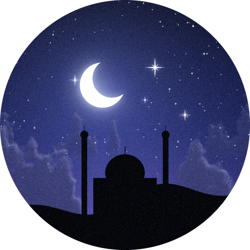
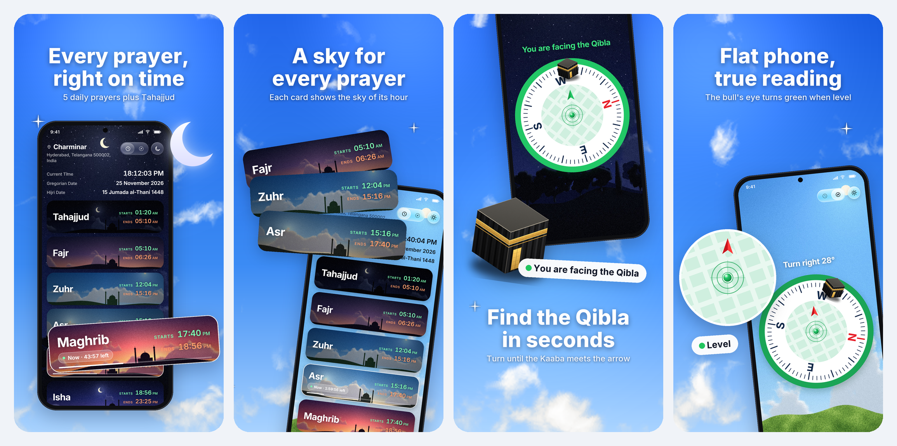
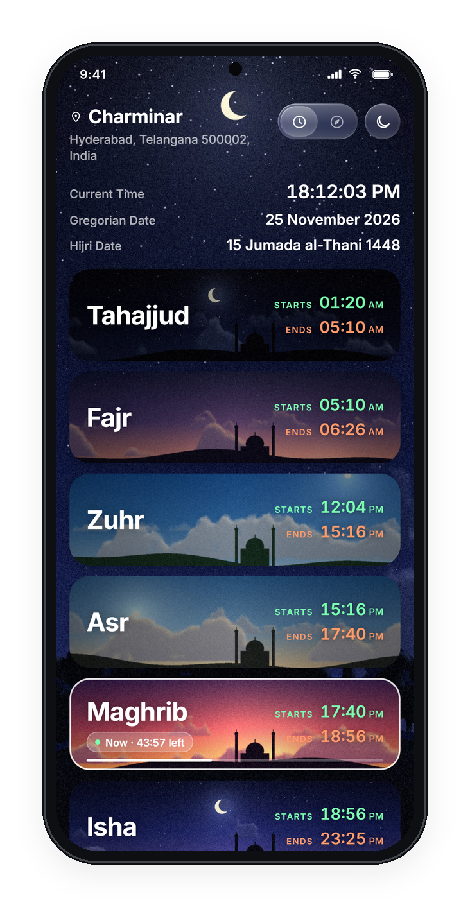
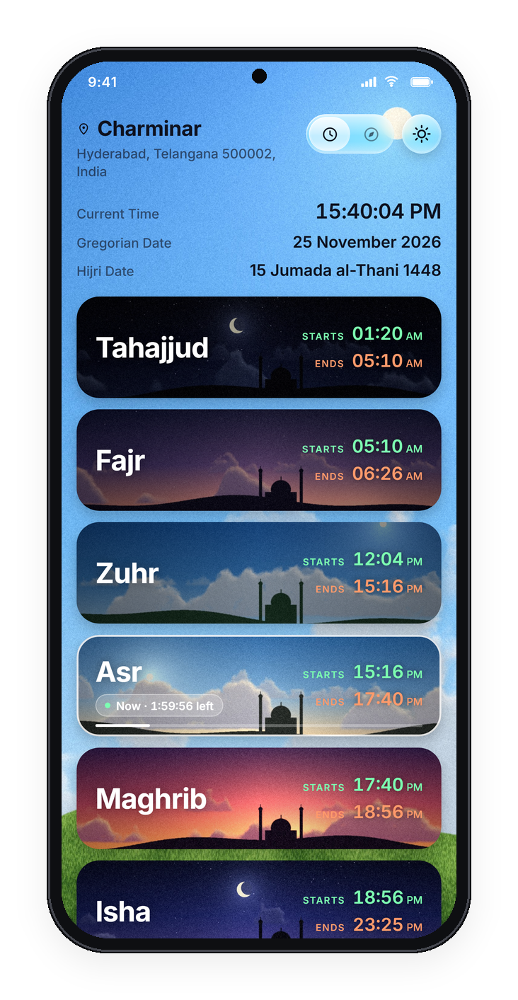
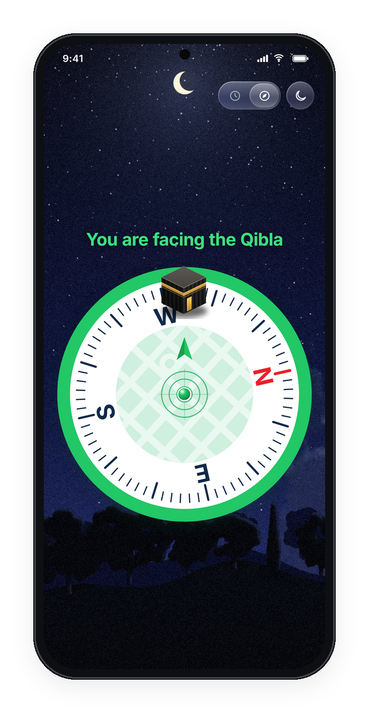
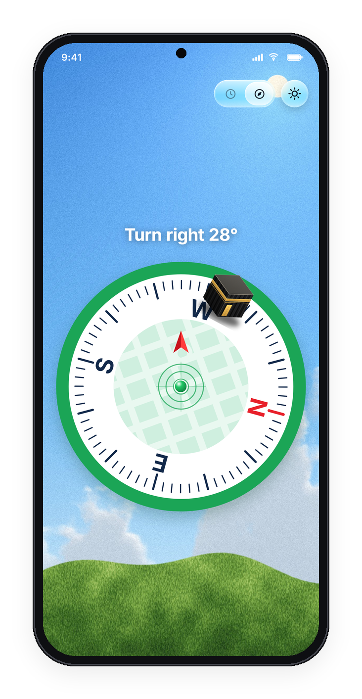

  

<h1 align="center">Namaz Timings</h1>

  Accurate prayer times and a Qibla compass, drawn on real skies. 
  Built with React Native and Expo for Android.

  

## What it does

Namaz Timings shows the 5 daily prayer times for wherever you are, plus Tahajjud as a complimentary night prayer, and points you to the Qibla. It works fully on your phone. There is no account, no server and no tracking.

## Features

### Prayer times

- The 5 daily prayers, Fajr, Zuhr, Asr, Maghrib and Isha, each with a start and an end time.
- Tahajjud as a complimentary night prayer, shown first, from the last third of the night until Fajr.
- Every prayer card shows a realistic sky for its hour: a starry night for Tahajjud, dawn for Fajr, bright noon for Zuhr, golden afternoon for Asr, sunset for Maghrib and twilight for Isha.
- The current prayer is highlighted with a live countdown and a progress bar.
- Your full address with PIN code, the current time, and the Gregorian and Hijri dates at the top.
- The calculation method is chosen from your location, so Fajr and Isha use the angles accepted in your region.

### Qibla compass

- A clear compass with a red north and a realistic Kaaba on the rim at your Qibla bearing.
- A fixed red arrow shows where your phone points. Turn until the Kaaba sits under it.
- A bull's eye spirit level in the centre. The bubble turns green only when the phone is flat, because a compass is only accurate when it is level.
- The phone vibrates once when you face the Qibla with the phone flat.
- Smooth needle movement: sensor readings are filtered and the dial always turns the short way.

### Look and feel

- Night theme from 6 PM to 6 AM and a fresh morning theme from 6 AM to 6 PM, switched automatically.
- A switch in the top corner flips the theme with a circular reveal.
- Liquid glass controls and film grain on every sky.

## App Screens

<table>
  <tr>
    <td align="center"></td>
    <td align="center"></td>
    <td align="center"></td>
    <td align="center"></td>
  </tr>
  <tr>
    <td align="center">Namaz times in dark theme</td>
    <td align="center">Namaz times in light theme</td>
    <td align="center">Qibla in dark theme</td>
    <td align="center">Qibla in light theme</td>
  </tr>
</table>

## License

Released under the [MIT License](LICENSE).
